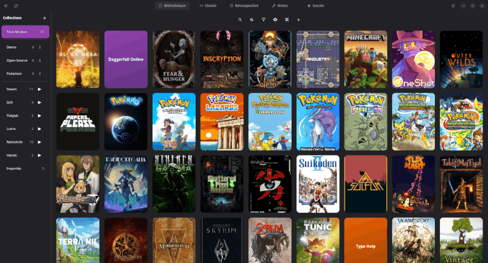

# Ludodex

A GTK4 / libadwaita game library manager that imports your games (Steam, itch.io, Flatpak, Lutris, RetroArch…), picks a **random game to play** based on your mood and the time available, and keeps a **retrospective** of your play sessions — all local, with a Markdown note per game and user-defined achievements tracked from game logs.

<p align="center">
  
</p>

**Why Ludodex?** You own hundreds of games across several launchers and still can't decide what to play. Ludodex puts them in one local library, picks one for you from your mood and the time you have, tells you how long it takes to beat (optional HowLongToBeat), and gives achievements to games that have none, by reading their logs.

- 🔒 **Local first**: one SQLite file, no account, no telemetry. Network features (SteamGridDB, IGDB, HowLongToBeat, RetroAchievements, Steam, community YAML repo) are optional and explicit; API keys live in separate `0600` files, never in the database.
- 🎲 **Pick** a game by mood, available time and status, with an animated roulette.
- 🏆 **Custom achievements** from game logs (YAML rules: counts, sequences, distinct values, sums, meta-achievements), plus a **community repository** in [`achievements/`](achievements/) — contributions welcome.
- 📊 **Retrospectives** (week / month / year) exportable to **HTML + CSS, PNG and PDF**.
- 🗂 Imports **Steam, Heroic, Lutris, itch.io, Flatpak, RetroArch** and custom entries.

> **AI disclosure.** Ludodex is developed with the help of an AI assistant (Claude, by Anthropic). A significant share of the code, tests and documentation was written or refactored with it — recent additions such as the rule engine, schema migrations, the HowLongToBeat / IGDB integrations, the community repository and the exports in particular. The author sets the direction, runs the app on a real library and decides what gets merged, and remains responsible for the result. Bug reports are welcome whatever the origin of the code, and the full history is in the commits. If that matters to you (some distribution channels have their own policy on AI-assisted software), you can judge from the source.

## Features

### Pick — the draw
Selects a game to play right now, weighted by:
- **status** (`In progress` is strongly favored, `To play` comes next);
- **moods**: each mood is a tag (`-m calm -m short`);
- **time available** (`-t 20` for 20 minutes), compared to each game's useful session length;
- **excluded tags** (hard filter, reversible);
- **freshness**: a recently played game keeps its momentum, a neglected backlog slowly rises.

Launch the picked game directly, or launch from the library.

### Library
- imports installed games (Steam, itch.io, Flatpak, Lutris, RetroArch) and manual additions;
- statuses (`In progress`, `To play`, `Paused`, `Dropped`, `Finished`) with automatic pause after 28 days without a session. A game only moves to `In progress` once a session has lasted **at least 5 minutes**: merely launching it — a 30-second try — no longer promotes it, and a status you set by hand (`Finished`, `Dropped`) is never overwritten;
- personal tags + store tags (Steam genres, itch.io keywords, Lutris genres), fetchable with the `tags` command;
- useful session length per game, SteamGridDB covers (optional API key, custom cover supported);
- manual and automatic collections (per platform), filters, hidden / not installed games.

### Retrospective
- **weekly**, **monthly** and **yearly** timelines (one column per day or per month), each independently toggleable in Settings;
- successive sessions of the same game are merged (≤ 5 min apart), plus a 0–15 min threshold to hide short sessions;
- duration shown for every session; day/month names follow the app's language.

### Notes
- one **Markdown note per game**, with a permanent live preview (clickable checkboxes, internal links, Markdown help);
- the line under the cursor shows the raw source, Obsidian-style;
- adjustable text size (8–40 pt), auto-save, "only noted games" filter.

### Achievements
- bring your own achievements for **modded games**: pick a game on the left, then attach a **YAML file** and the game's **log file** to it;
- each achievement tests the **log lines** with regular expressions: `match` (one pattern), `any` (at least one), or `all` (every pattern), with an optional `count` (e.g. "defeat 50 bandits");
- richer rules (see `achievements/README.md`): `sequence` (ordered), `distinct` (N different values), `sum` / `max` (numbers captured in the line), `all_of` / `any_of` (meta-achievements on other ids), and modifiers `exclude`, `reset_on`, `requires`, `case_insensitive`; `repo validate` / `lint` check a file before use;
- `hidden: true` marks an achievement as secret: its name, description and icon stay masked until it is unlocked;
- the log is read **incrementally** (each line is counted once); a truncated or rewritten log is detected and re-scanned from the start;
- per-game panel with progress (`x/N`) and unlock dates — the counter under the title always shows **all three sources combined** (YAML-tracked, RetroAchievements *and* Steam), in the same place; a ready-to-adapt example lives in `achievements/openmw/openmw-achievements.yaml` along with the logger mod for OpenMW in `achievements/openmw/LudodexLogger-OpenMW.zip`;
- the achievements of a game can be **filtered** (all / unlocked / locked, plus an accent-insensitive search over titles and descriptions) and **sorted** (original order, A→Z, Z→A, unlocked first, locked first); the settings persist across games;
- a single **refresh** button re-reads the log *and* syncs that game with RetroAchievements (when it is linked) and Steam (when it comes from Steam) — no separate buttons;
- **auto-refresh**: every 5 seconds the app checks the log file of each tracked game, and re-reads it automatically when it changes — so the achievements update on their own **while you play**; one final re-read happens when the writing stops (the game just closed), and a toast announces any newly unlocked achievements. The same signal also **re-syncs RetroAchievements** for a linked game and **Steam** for a Steam game, and a single toast covers the unlocks of all three sources. Each kind of game is watched through its own file, updated while you play — same principle, no process inspection: a YAML-tracked game through its log, a RetroArch game through its per-game runtime file (`…/playlists/logs/<core>/<game>.lrtl`), a Steam game through `steamapps/appmanifest_<appid>.acf`, where Steam writes `LastPlayed`. Nothing runs when no game is writing: the check is a single `stat()` per watched game.
- a **reset** button (with confirmation) clears a game's progress without recounting the log lines already read; on a game followed *only* through a downloaded source (RetroAchievements or Steam) it instead **removes the game from the list** (unlinks the account and purges the downloaded cache), since there is no local progress to clear;
- **RetroAchievements sync**: your username and Web API key live in the global app settings (Settings → Achievements), where "Sync account" links your games to their RetroAchievements entries by title and stores their achievements (badges, points, unlock dates). This is how RetroArch achievements show up, since RetroArch keeps them on the RetroAchievements servers. RetroAchievements are listed **inline with the tracked ones** (no separate section header): the counter under the game title is the combined total, above the search bar;
- **RetroAchievements on/off**: the same page has a *Use RetroAchievements* switch. When it is off, RetroAchievements are hidden everywhere (list, detail, counter), games known only through RetroAchievements leave the game list, no API call is made — and YAML-tracked achievements keep working as usual;
- **Steam achievements**: the same page has a *Steam* group, with the same shape as the RetroAchievements one. Paste your **Web API key** (generated on steamcommunity.com/dev/apikey); your **Steam ID** is read automatically from your local `userdata` folder, so it is usually already filled in. "Sync my games" then downloads the achievements of the Steam games you own or have played, and they show up **inline with the other sources**. No title matching is needed: a game imported from Steam already carries its appid. Games without Steam achievements are simply not kept, so they never clutter the list. The sync runs **in the background** — a real account is ~120 games and two API calls each, so the button is disabled, the row shows `Fetching… (i/total)` and the interface stays usable until a toast reports how many games were downloaded;
- **Steam on/off**: the same *Use Steam achievements* switch hides Steam achievements everywhere, makes Steam-only games leave the game list and stops every API call — while YAML-tracked achievements and RetroAchievements keep working as usual;
- **secret achievements** are masked by default (name, description and icon replaced by a generic label until unlocked); the flag comes from the log (YAML) or from Steam's own `hidden` field, so a secret Steam achievement is masked too, and reveals itself as soon as it is earned. The global setting *Reveal hidden achievements* (Settings → Achievements) reveals them everywhere, including in `ludodex tracker status`. The search bar can **not** find a masked achievement by its real name or description — otherwise typing a guess and seeing a row appear would give the spoiler away.

### Overlay
A small overlay drawn **over the game** when you launch it from Ludodex (Wayland, [`gtk4-layer-shell`](https://github.com/wmww/gtk4-layer-shell)). It is a **separate process** (`ludodex-overlay`): nothing is injected into the game — no `LD_PRELOAD`, no hook — the compositor does the stacking. It stops by itself when the game's session ends.
- **Shift+Tab** opens / closes it. Closed, it only shows the widgets marked *Always visible* (and achievement pop-ups), and mouse and keyboard go straight to the game. Open, every widget can be **dragged anywhere** by its header and tuned with its ⚙ (opacity, always visible, options); positions are saved as fractions of the screen, so they survive a resolution change. Settings live in `~/.local/share/ludodex/overlay.json`.
- Widgets: **clock** (clock 12/24 h with or without seconds, session time, stopwatch, countdown), **achievement unlocked** pop-up (YAML, RetroAchievements and Steam; it watches what the app already records), and the game's **notes** (editable, auto-saved to the same note as the Notes page).
- **Follows the game window.** The overlay is scaled with the game window (`height / 1080`, kept between 50 % and 300 %, on top of each widget's own text size) and **hides while the game is minimized or not focused** (`only_when_focused`; open, it never hides itself, and Shift+Tab does nothing while the game isn't focused). In CyberRealm "focused" means the game window is in focus mode (`SUPER+F`): the overlay is drawn above it and takes the mouse while open; outside focus mode it stays hidden. Wayland doesn't let a client see other windows, so each compositor is asked its own way: **KDE** (a KWin script loaded over D-Bus), **Hyprland** (`hyprctl`) and **CyberRealm** (`cyberrealm-exec windows`); elsewhere the scale stays 1. The window is found by the PID of the launched game and its children (or the game's install folder), else by the game's name in the title. `scale_with_game` and `reference_height` in `overlay.json` tune or disable it. Hyprland has no "minimize": a window sent to a special workspace counts as minimized.
- Turn it off in Settings → Overlay. Requires `gtk4-layer-shell` (your distro's `gtk4-layer-shell` package, e.g. `pacman -S gtk4-layer-shell`; the Flatpak bundles it) and a compositor with the layer-shell protocol (wlroots: sway, Hyprland, river, dwl…; KDE; not GNOME/Mutter). Without it the game launches normally, without overlay.
- **Global shortcut.** Wayland doesn't let an application read keys without focus. Ludodex asks the XDG *GlobalShortcuts* portal for Shift+Tab (KDE, Hyprland, recent GNOME, and CyberRealm, which implements it). Where the portal isn't available (sway, dwl, river…), bind a compositor key to `ludodex-overlay --toggle` (Flatpak: `flatpak run --command=ludodex-overlay io.github.AdrienPiechocki.Ludodex --toggle`), e.g. sway/Hyprland: `bindsym Mod4+Tab exec ludodex-overlay --toggle` / `bind = SUPER, Tab, exec, ludodex-overlay --toggle`. Binding bare Shift+Tab would take it from every application.
- Limits: a game that **locks the mouse pointer** keeps it while the overlay is open (the keyboard — notes — still works): without injection a Wayland client can't release another client's pointer lock. The overlay closes with the *session*; a game launched through a launcher URI that Ludodex cannot follow keeps its session (and the overlay) open until you press *End session*. The PyInstaller build does not bundle `gtk4-layer-shell`.

### Play time tracking
Every launch through Ludodex opens a **session**; its duration is recorded when it closes. Closing a session is also the only moment that can move a game to `In progress`, since it is the first time its real length is known — and only if it reached 5 minutes. Steam history (minutes played, last launch) is imported locally with `backfill`, no API needed. Both the interface and the CLI show total play time, the timelines, and rankings.

## Installation

### Quick install (Flatpak, nothing to clone)

Download **`ludodex.flatpak`** from the [latest release](../../releases/latest), then:

```sh
flatpak install --user ./ludodex.flatpak      # the GNOME runtime is fetched from Flathub if missing
flatpak run io.github.AdrienPiechocki.Ludodex
```

The command line is bundled too: `flatpak run --command=ludodex-cli io.github.AdrienPiechocki.Ludodex <command>`
(every `python3 picker.py <command>` below becomes that). Community achievements, covers,
HowLongToBeat and exports all work from the package; nothing else needs installing.

### Linux

Dependencies: Python 3, PyGObject, GTK 4, libadwaita, Cairo and PyYAML (Debian/Ubuntu: `python3-gi python3-gi-cairo gir1.2-gtk-4.0 gir1.2-adw-1 python3-yaml`).

```sh
git clone <repo-url> ludodex
cd ludodex
python3 gui.py          # graphical interface
python3 picker.py --help  # command line
```

### Standalone build (PyInstaller)

`./build.sh` produces `build/ludodex/` with `ludodex` (interface), `ludodex-cli` (CLI) and `_internal/` (embedded Python, GTK4, libadwaita and translations). See `ludodex.spec`.

### Flatpak

`io.github.AdrienPiechocki.Ludodex.yml` builds the app from source with the GNOME
runtime (GTK4, libadwaita and PyGObject come from the runtime; only PyYAML is
installed at build time). Games are launched on the host through
`flatpak-spawn --host`, so the sandbox needs `--filesystem=host` and
`--talk-name=org.freedesktop.Flatpak`.

```sh
sudo pacman -S flatpak-builder        # (or your distribution's equivalent)
flatpak install --user flathub org.gnome.Platform//51 org.gnome.Sdk//51
flatpak-builder --force-clean --user --install --repo=build/repo build/flatpak io.github.AdrienPiechocki.Ludodex.yml
flatpak build-bundle build/repo build/ludodex.flatpak io.github.AdrienPiechocki.Ludodex
```

`ludodex.flatpak` is attached to each GitHub release **automatically**: pushing a tag (`X.Y.Z` or `vX.Y.Z`) runs `.github/workflows/release.yml`, which builds the bundle and publishes it. To build it yourself (replace the last command's output path with `build/ludodex.flatpak`), install it with:

```sh
flatpak install --user ./ludodex.flatpak
```

Run it with `flatpak run io.github.AdrienPiechocki.Ludodex`; the CLI is exported as
`ludodex-cli` (or `flatpak run --command=ludodex-cli io.github.AdrienPiechocki.Ludodex …`).
The database stays at `~/.local/share/ludodex/games.db`, shared with any source checkout.
Sessions: the game process is watched through the host (`/proc` is namespaced inside
the sandbox), so sessions close as usual when a game exits; when no process motif is
known, the session falls back to closing on the next launch or when the app closes.

## Usage

```
python3 picker.py <command> [options]
# from the Flatpak: flatpak run --command=ludodex-cli io.github.AdrienPiechocki.Ludodex <command> [options]
```

| Command | Effect |
|---|---|
| `import` | Imports games from all enabled platforms |
| `pick` | Draw: `-t` minutes, `-m` moods, `-c` collection(s), `-x` excluded tags, `--mood-mode any/all` |
| `set` | Status, tags, session length, cover (`--status`, `--tags`, `--min`, `--cover`, `--clear-cover`) |
| `add` | Game outside platforms (launch command) |
| `rename` | Rename (survives re-imports; `""` restores the original name) |
| `note` | Shows a note, or replaces it (`""` clears it) |
| `exe` | Shows/replaces the launch command (`""` restores the default) |
| `list` | Lists games |
| `lang` | Shows or changes the language (no argument: current language) |
| `stats` | Week + month + year retrospective, then ranking by play time |
| `backfill` | Imports Steam history (local sessions, no API) |
| `hide` / `unhide` | Hides or brings back a game |
| `col` | Collections: `list`, `add`, `rename`, `del`, `show`, `add-game`, `remove-game` |
| `tags` | Fetches store tags (`-n` limit, `--retry`) |
| `diag` | Game diagnostic (name, status, tags, launch…) |
| `covers` | SteamGridDB covers (`-n`, `--retry`, `--status`) |
| `cover` | Forces a game's SteamGridDB ID |
| `tracker` | Achievements from a game log: `list`, `attach <game> <yaml> <log>`, `status`, `scan`, `clear`, `reset` |
| `export` | Retrospective to a file: `export week\|month\|year html\|png\|pdf [-o file] [--game text] [--date YYYY-MM-DD] [--inline] [--theme dark\|light]` |
| `hltb` | HowLongToBeat durations (optional, explicit): `fetch` (`-n`, `--retry`), `show`, `set <game> --main/--extra/--complete <h>`, `link <game> <id>` |
| `igdb` | IGDB cover fallback (optional): `login <client_id> <client_secret>`, `status`, `test`, `clear` |
| `repo` | Community achievements: `list`, `search`, `info`, `install <id> [--game <game> --log <file>] [--mod]`, `installed`, `update`, `uninstall`, `validate <file.yaml>`; `LUDODEX_REPO` overrides the source |
| `ra` | RetroAchievements: `login <user> <api_key>`, `status`, `sync`, `show <game>`, `link <game> --game <id>` |

Examples:

```sh
python3 picker.py import
python3 picker.py pick -t 30 -m calm -c "To finish"
python3 picker.py stats
python3 picker.py note "Hollow Knight" "- [x] beat the final boss"
python3 picker.py tracker attach "OpenMW" achievements/openmw/openmw-achievements.yaml ~/.local/share/openmw/openmw.log
python3 picker.py tracker status "OpenMW"
```

## Data

The local database is a SQLite file: `~/.local/share/ludodex/games.db`

The data folder also holds the covers and the API keys, **each in its own file outside the database** (`steamgriddb.key`, `igdb.key`, `steam.key`, `ra.key`, mode 0600), so `games.db` can be copied or shared without leaking a secret. Keys left in the database by older versions are moved to these files automatically at the next start and erased from `games.db`. Schema changes are **versioned migrations** (`PRAGMA user_version`, one transaction each); a backup `games.db.bak-v<N>` (last 3 kept) is made before any migration, and a database from a newer Ludodex is refused instead of being damaged. IGDB / HowLongToBeat credentials and data stay local, and neither service is contacted unless you configure or trigger it.

A legacy `gamepicker` folder is picked up automatically (once). Backup = copy `games.db`.

## Languages

The base language is English: code strings are the keys, each language is a `lang/<code>.json` file (see `lang/fr.json`). To add a language, drop in a `lang/<code>.json` — nothing else to change. The language is detected at startup and can be changed in Settings or via the `lang` command.

## Project structure

```
gui.py        graphical entry (re-exports Win/App, run python3 gui.py)
picker.py     facade: re-exports core/* (used by gui and the CLI) and the CLI entry
i18n.py       translation engine (tr, detection, set_lang)
core/         logic: db, platform, sources, importers, steam, tags, covers,
              launch, stats, pick, game_collections, tracker, rules, ra, hltb,
              community, export, export_draw, migrations, cli
overlay/      in-game overlay (separate process): app, config, data, shortcut
overlay_main.py  `ludodex-overlay` entry (--game ID | --toggle | --quit)
ui/           GTK4 interface: main, theme, pickview, library, retrospec,
              notes, markdown, achievements, settingsui
lang/         translations (en = base, fr)
achievements/ community YAML files, one folder per game + index.json (SHA-256)
tools/        build_index.py (regenerates achievements/index.json; CI checks it)
tests/        pytest suite (migrations, rules, covers, hltb, community, export)
share/        application logo: master PNG, hicolor sizes
local.ludodex.desktop  Linux launcher (installed to ~/.local/share/applications)
build.sh      standalone PyInstaller build (ludodex.spec)
requirements.txt   the only pip dependency (PyYAML); gi/cairo come from the OS
```

## License

MIT — © 2026 AdrienPiechocki.
